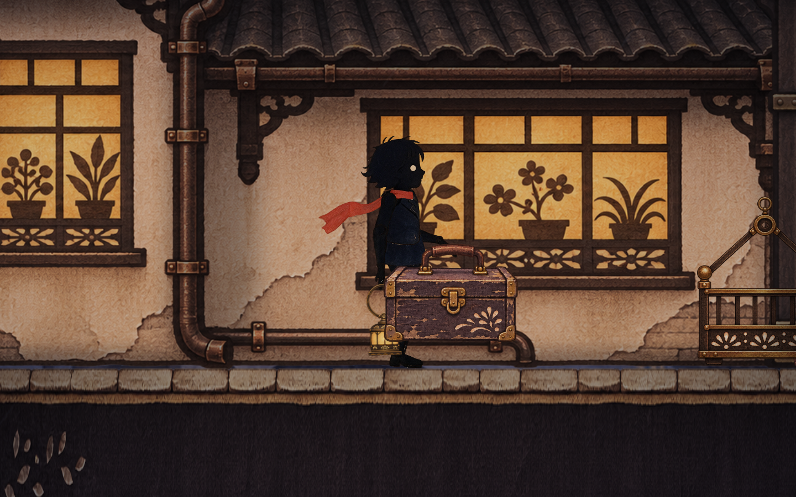

# 借光街 · Borrowed Light Street

在雨夜的小街提灯前行，用光与影搭出道路，移动日常物件，解开街巷中的机关。

**[在线试玩](https://doyitnow.github.io/borrowed-light-street/?v=0.1.0-preview.2)** · **[下载 Windows 版](https://github.com/DoYitNow/borrowed-light-street/releases/download/v0.1.0-preview.2/BorrowedLightStreet-Windows-2026.11.11-032904.zip)**

当前为电脑键鼠试玩版，已在 Windows Chrome 中实测。网页打开后自动加载游戏，不显示提示、按钮或边框；首次加载约 192 MB，首次点击画面或按键后进入全屏，可按 `Esc` 返回。

小道具可以用 `F` 拿走、带到别处再放下，大件可以扶住后用方向键整体推动，`R` 恢复初始摆放。椅子须从背后抓握。最后的拼影需包含公文箱，箱子与独立挂伞均在人物的画面右侧；参考房间里的新壁画。

| 按键 | 操作 |
|---|---|
| `A / D` 或 `← / →` | 移动 |
| `Shift` | 奔跑 |
| `空格` 或 `W` | 跳跃 |
| `E` | 提起、放下灯 |
| `F` | 交互、拿放或悬挂物品、扶住与松开大件 |
| `L` | 切换区域灯光 |
| `S + 空格` | 从影子平台下落 |
| `R` | 回到起点 |

Windows 版下载 ZIP 后完整解压，运行 `BorrowedLightStreet.exe`；保留旁边的游戏数据文件和目录。

当前版本为 `0.1.0-preview.2`。遇到问题可以在 [Issues](https://github.com/DoYitNow/borrowed-light-street/issues) 留下浏览器版本、操作步骤和截图。

本仓库用于发布游戏成品和更新说明。下载校验值见每个 Release 的 `SHA256SUMS.txt`；部署配置说明见 [DEPLOYMENT.md](DEPLOYMENT.md)。
